# Proyecto Ordinario · Estructuras de Datos y Algoritmos

Universidad Anáhuac Mayab · Estructuras de Datos y Algoritmos (202660_50560) · Lizbeth Hernández Olán

**Equipo ProyectoFinal 5:** Aranza Aguilar Madrigal, Ariana Belén Chinchilla Salazar, Diego Kamil Olea Ruiz, Erwin Deangelo Torres.

Este repositorio junta los seis proyectos del ordinario en un solo programa en Java. Cada proyecto conserva sus clases y su estructura de datos, y además tiene su propia pantalla gráfica e interactiva dentro de un **dashboard hecho con Swing** (solo Java, sin librerías externas).

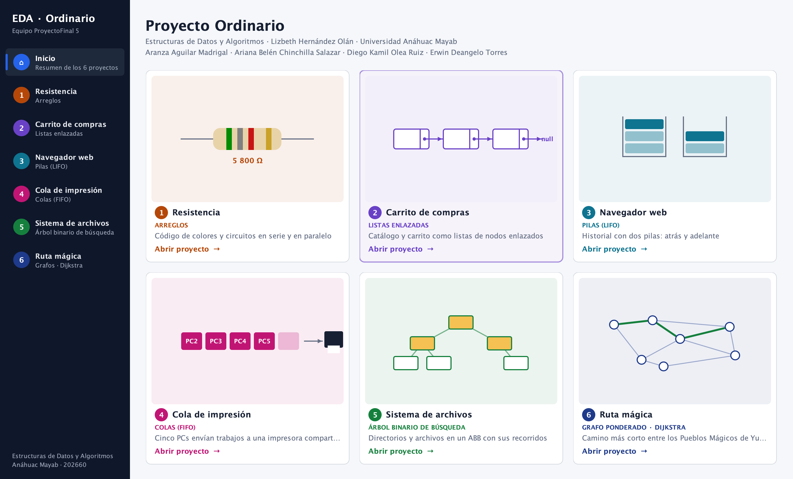

| # | Proyecto | Estructura | Paquete |
|---|---|---|---|
| 1 | Resistencia eléctrica | Arreglos | `resistencia` |
| 2 | Carrito de compras | Listas enlazadas | `carrito` |
| 3 | Navegador web | Pilas (LIFO) | `navegador` |
| 4 | Cola de impresión | Colas (FIFO) | `cola` |
| 5 | Sistema de archivos | Árbol binario de búsqueda | `archivos` |
| 6 | Ruta mágica (Yucatán) | Grafo ponderado · Dijkstra | `rutamagica` |

## Cómo ejecutarlo

Requisito: JDK 17 o superior.

```bash
./ejecutar.sh
```

En Windows: `ejecutar.bat`. El script compila todo en `out/` y abre el dashboard.

Cada proyecto también conserva su versión de consola:

```bash
./ejecutar.sh carrito
```

Las opciones son `resistencia`, `carrito`, `navegador`, `cola`, `archivos` y `ruta`.

Sin scripts:

```bash
javac -encoding UTF-8 -d out $(find src -name '*.java')
java -cp out dashboard.Dashboard
```

## El dashboard

La barra lateral lleva a cada proyecto por separado; la pantalla de inicio tiene una tarjeta por proyecto con un dibujo de su estructura. Cada proyecto tiene una barra inferior que explica lo que acaba de pasar (verde = correcto, ámbar = aviso, rojo = error de validación).

### 1. Resistencia eléctrica (arreglos)

- Escribe un valor (10 Ω a 99 000 000 000 Ω) y la resistencia se dibuja con sus tres bandas, el dígito o multiplicador de cada una y la fórmula.
- La tabla de la derecha es el arreglo `ColorResistencia.values()`: el índice es a la vez el dígito y el exponente. Se resaltan los colores usados.
- Si el valor tiene más de dos dígitos significativos, avisa cómo queda marcado (por ejemplo 165 Ω → 160 Ω).
- Genera n resistencias aleatorias (10 a 1 000 000 000 Ω) y dibuja el circuito en serie o en paralelo con el total.

| Paralelo | Serie |
|---|---|
| 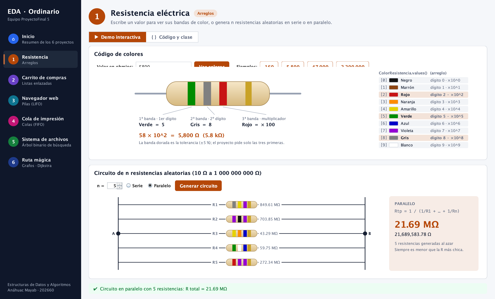 | 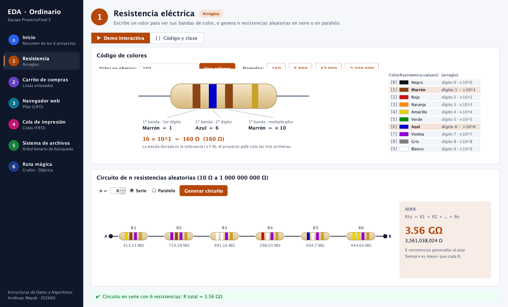 |

### 2. Carrito de compras (listas enlazadas)

- El catálogo es una `ListaProductos` y el carrito una lista de `NodoCarrito`; el carrito se dibuja nodo por nodo con su apuntador al siguiente y `null` al final.
- Buscar por ID o por nombre, agregar con cantidad (si el producto ya está, se suma al mismo nodo), seleccionar un nodo con clic y cambiar su cantidad, eliminar por selección, ID o nombre, vaciar y finalizar la compra (ticket con artículos y total).

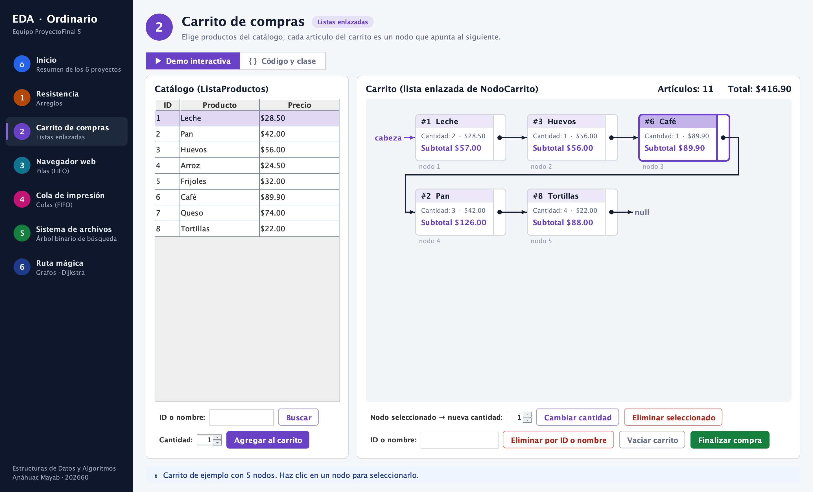

### 3. Navegador web (pilas)

- Barra de direcciones con Back, Forward, Visitar y Exit, y una ventana de navegador que muestra la página actual (o un 404 si no está en el catálogo local).
- Las dos pilas (atrás y adelante, capacidad 5) se dibujan con su cima. Visitar vacía la pila adelante; si una pila se llena se descarta la página más antigua.

| Historial | Página inexistente |
|---|---|
| 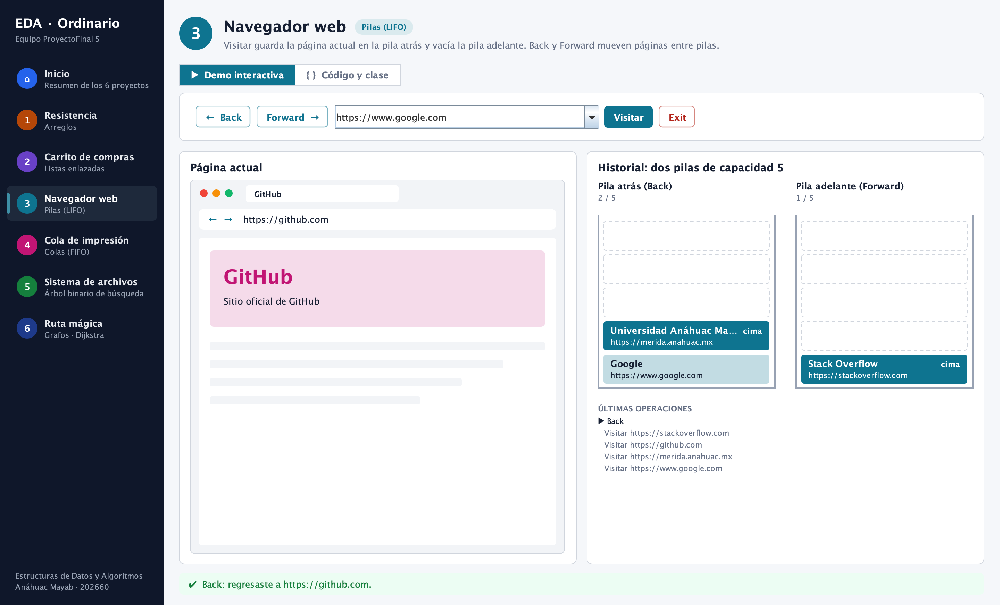 | 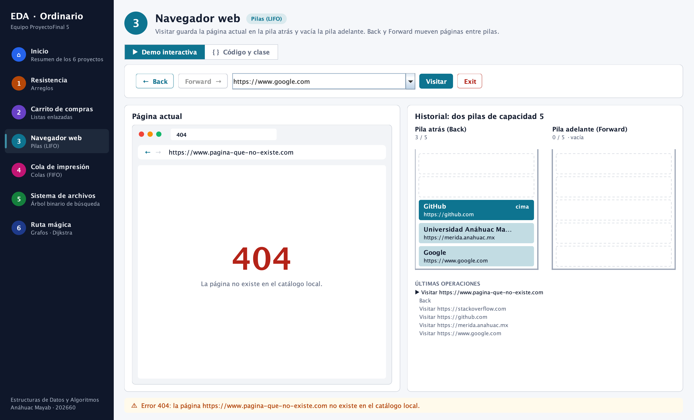 |

### 4. Cola de impresión (colas)

- Cinco computadoras, una cola de 6 lugares y una impresora. "Agregar trabajo" elige una PC al azar; también se puede hacer clic en una PC.
- Los trabajos entran por el final y "Imprimir" atiende el frente, con animación. Muestra "LLENA" y "VACÍA" cuando corresponde y el historial de impresos en orden de llegada.

| Cola con trabajos | Cola llena |
|---|---|
| 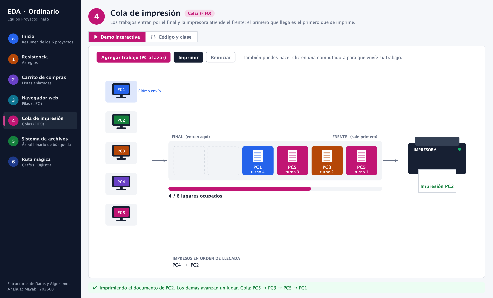 | 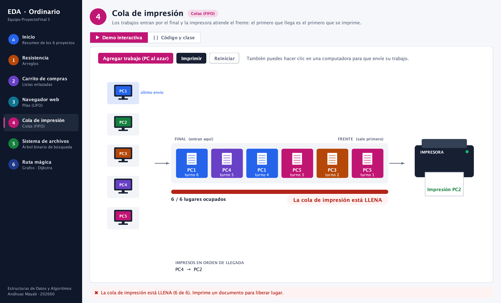 |

### 5. Sistema de archivos (árbol binario de búsqueda)

- El árbol se dibuja con una columna por posición inorden, así que se lee en orden alfabético de izquierda a derecha. Directorios en amarillo; archivos con su extensión.
- Insertar valida las reglas: nombre no vacío, sin duplicados, archivo con extensión, directorio sin extensión, tamaño no negativo y nunca debajo de un archivo.
- Buscar resalta el camino que siguió la comparación desde la raíz.
- Eliminar aplica los tres casos del ABB (hoja, un hijo, dos hijos con sucesor inorden) y explica cuál se usó. La raíz no se puede eliminar.
- Recorridos inorden, preorden y postorden animados nodo por nodo.

| Búsqueda | Inorden | Eliminación (caso 3) |
|---|---|---|
| 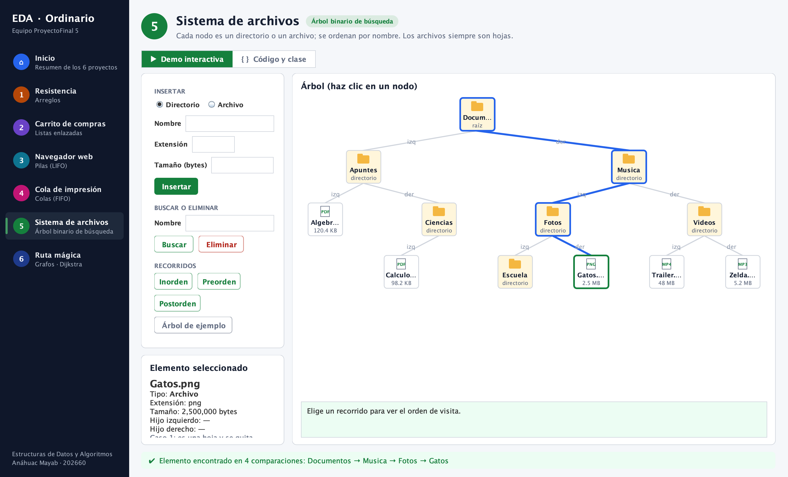 | 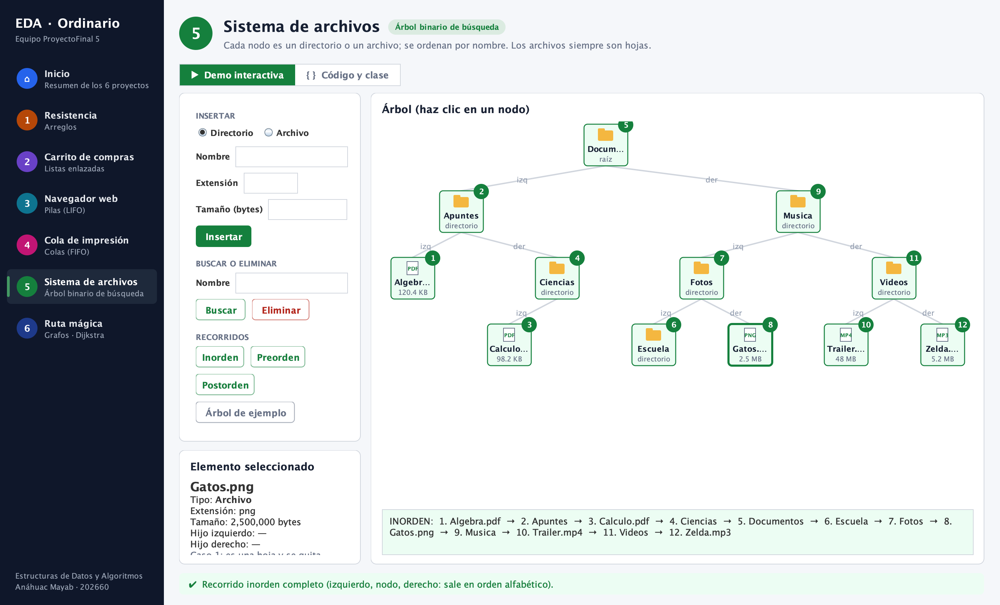 | 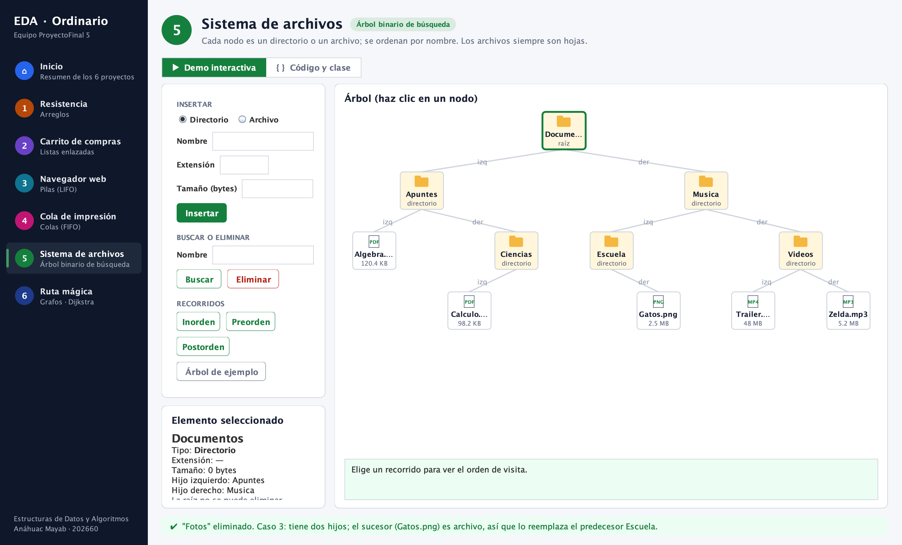 |

### 6. Ruta mágica · Yucatán (grafos)

- Los 7 Pueblos Mágicos de Yucatán sobre un mapa esquemático (posición por latitud y longitud) y las 10 carreteras con sus km. El grafo se lee de `datos/pueblos_yucatan.txt`.
- Clic en un pueblo para el origen y en otro para el destino: Dijkstra calcula la ruta más corta, la resalta en verde y lista cada tramo y la distancia total.
- "Dijkstra paso a paso" anima el algoritmo: qué pueblo sale de la cola en cada paso y cómo cambia la tabla de distancias (tentativa o definitiva).

| Sisal → Espita (218 km) | Paso a paso |
|---|---|
| 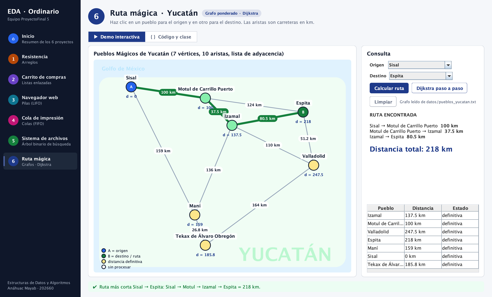 | 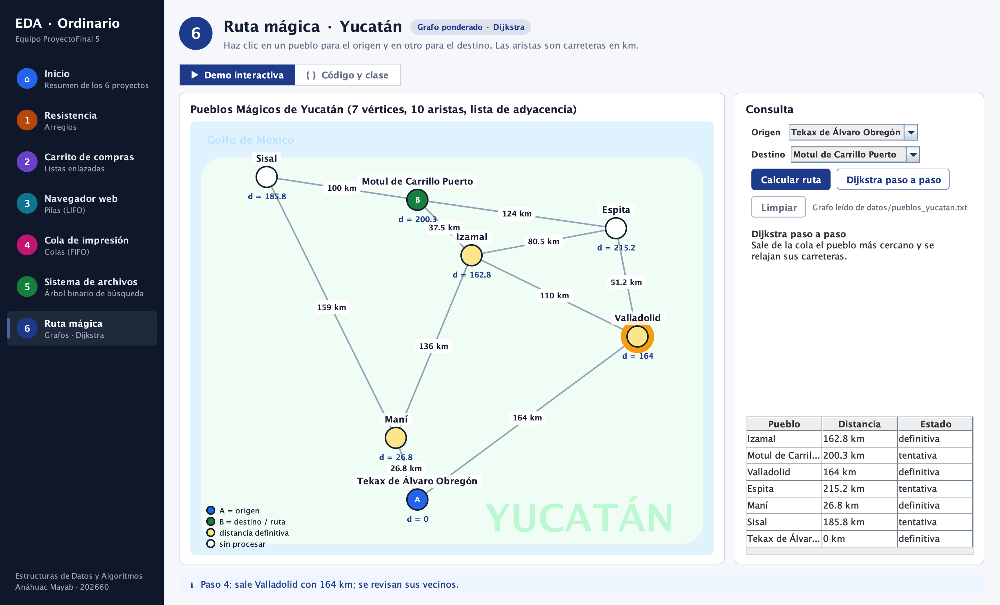 |

## Código y clase (rama `explicacion-clase`)

En esta rama cada proyecto tiene dos vistas, que se cambian con los botones de arriba: **Demo interactiva** (la de siempre) y **Código y clase**. La segunda explica qué funciones usamos y cómo se relacionan con lo visto en clase (Brightspace › Contenido › Parcial 1 y Parcial 2):

- A la izquierda, las funciones del proyecto.
- Arriba a la derecha, el tema de clase y su material de Brightspace, y una explicación de cómo se relaciona el código con lo que vimos.
- Abajo, el código real del método (raw), con números de línea y la ruta del archivo. Se lee en el momento desde `src/`, así que siempre coincide con el programa que se ejecuta.

| # | Proyecto | Funciones explicadas | Tema de clase |
|---|---|---|---|
| 1 | Resistencia | `porIndice`, constructor de `Resistencia`, `generarResistencias`, `calcularTotal` (paralelo) | Parcial 1: arreglos y pilas |
| 2 | Carrito | `agregarProducto`, `eliminarPorId`, `calcularTotal` | Parcial 1: listas enlazadas |
| 3 | Navegador | `apilar`, `desapilar`, `atras` | Parcial 1: pilas |
| 4 | Cola de impresión | `encolar`, `atender` | Parcial 1: colas |
| 5 | Sistema de archivos | `insertar`, `buscar`, `inorden`, `eliminar` | Parcial 2: 6. Árboles |
| 6 | Ruta mágica | `agregarCarretera`, `Dijkstra`, `getRuta`, `desdeLineas` | Parcial 2: 7. Grafos y El camino más corto |

| Sistema de archivos | Ruta mágica |
|---|---|
| 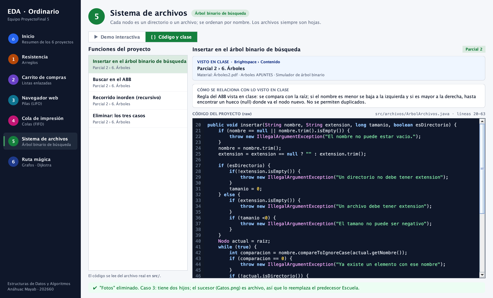 | 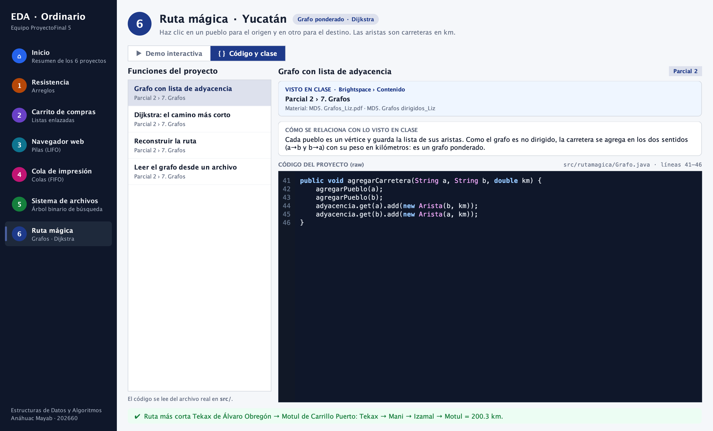 |

Las referencias están en `src/dashboard/clase/CatalogoClase.java` (una lista por proyecto); para agregar una función basta con añadir otra `Referencia` con el archivo y el inicio de su firma.

## Estructura del repositorio

```
src/
├── dashboard/              ventana principal, tema visual, inicio y capturas
│   ├── proyectos/          una pantalla por proyecto (ProyectoResistencia, ProyectoCarrito, …)
│   └── clase/              pestaña "Código y clase": referencias a la clase y lector del código
├── resistencia/            proyecto 1: modelo, estructuras y vista originales
├── carrito/                proyecto 2: Producto, NodoProducto, ListaProductos, Carrito, …
├── navegador/              proyecto 3: modelo (Pila, Navegador, …), consola y ventana original
├── cola/                   proyecto 4: ColaImpresion
├── archivos/               proyecto 5: Nodo, ArbolArchivos, ventana original
└── rutamagica/             proyecto 6: Arista, Grafo, Dijkstra, RutaMagica
datos/pueblos_yucatan.txt   grafo de la ruta mágica
docs/documentacion/         documentación de cada proyecto (5 fases) en PDF
docs/capturas/              imágenes del dashboard
```

## Cambios hechos al integrar los proyectos

Las clases de cada proyecto se copiaron de su repositorio original y se les agregó un `package`. Solo se añadieron métodos que el dashboard necesitaba, sin quitar los que ya existían:

- `Carrito.obtenerItems()` y `ListaProductos.obtenerProductos()`: recorren la lista enlazada y regresan sus elementos para dibujarlos.
- `ColaImpresion`: `encolar`, `atender`, `getTrabajos`, `estaLlena` y `estaVacia` regresan el resultado en lugar de solo imprimirlo. Los métodos de consola se mantienen y ahora los usan.
- `ArbolArchivos.eliminar`: ahora cubre los tres casos que pide el enunciado. En el caso de dos hijos lo reemplaza el sucesor inorden; si el sucesor es un archivo (y por lo tanto no puede tener hijos) se usa el predecesor. También se agregaron `caminoBusqueda` y `altura`.
- `Grafo.desdeLineas` y `Dijkstra.getPasos`: permiten cargar el grafo sin archivo y mostrar el algoritmo paso a paso.

## Documentación

Cada proyecto tiene su documentación con las cinco fases (contextualización, requerimientos, diseño UML, codificación y pruebas):

1. [Resistencia](docs/documentacion/01_Resistencia.pdf)
2. [Carrito de compras](docs/documentacion/02_Carrito_de_compras.pdf)
3. [Navegador web](docs/documentacion/03_Navegador_web.pdf)
4. [Cola de impresión](docs/documentacion/04_Cola_de_impresion.pdf)
5. [Sistema de archivos](docs/documentacion/05_Sistema_de_archivos.pdf)
6. [Ruta mágica · Yucatán](docs/documentacion/06_Ruta_magica_Yucatan.pdf)

Repositorios originales: [resistencia_ord](https://github.com/diegoanahuac/resistencia_ord/tree/Resistencia_main), [CarritoDeCompras](https://github.com/CosmicKringle/CarritoDeCompras), [Navegador_Web_E5](https://github.com/diegoanahuac/Navegador_Web_E5), [ColaImpresion](https://github.com/CosmicKringle/ColaImpresion), [SistemasdeArchivos](https://github.com/CosmicKringle/SistemasdeArchivos), [Ruta_Magica_Yucatan](https://github.com/diegoanahuac/vectores/tree/ruta-magica-final/Ruta_Magica_Yucatan).
